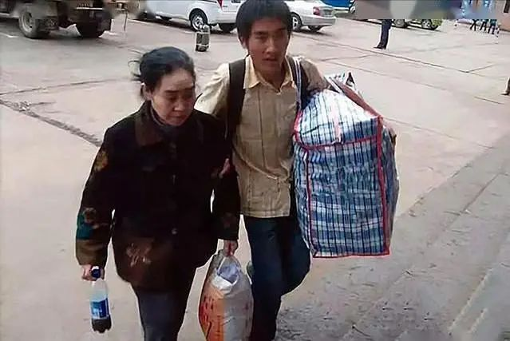
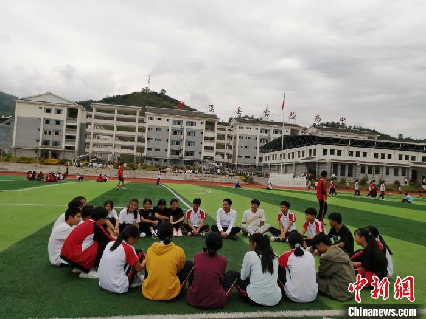
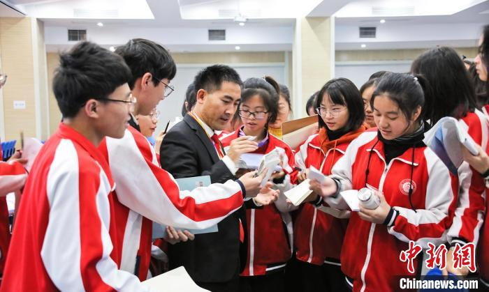
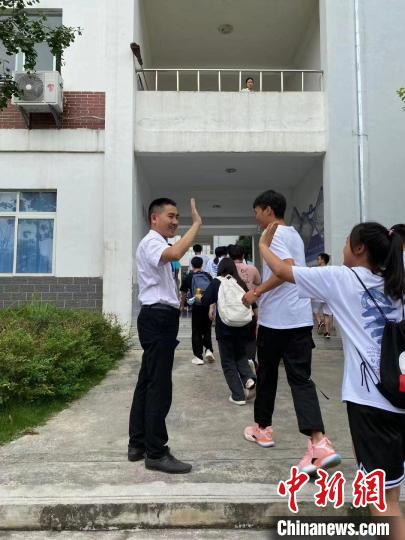
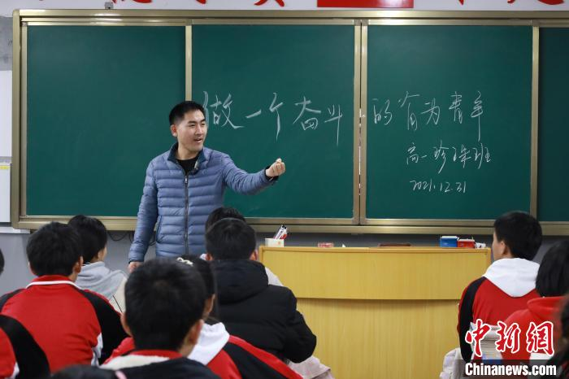

Có những người bước ra khỏi nghịch cảnh để tìm một cuộc sống dễ dàng hơn.
Lưu Tú Tường lại chọn quay về nơi mình từng muốn rời đi nhất.

<figure class="story-figure story-figure-wide">
  
  <figcaption>Ảnh tư liệu thời Lưu Tú Tường còn đi học cùng mẹ. Ảnh: The Paper, ảnh tư liệu.</figcaption>
</figure>

Anh sinh ra ở huyện Vọng Mô, tỉnh Quý Châu, Trung Quốc. Khi còn nhỏ, cha
qua đời vì bệnh. Mẹ vì cú sốc ấy mà mắc bệnh tâm thần. Đến năm học lớp ba,
các anh chị lần lượt rời quê đi làm, trong nhà chỉ còn Lưu Tú Tường chăm sóc
mẹ và tự lo việc học.

Con đường đến trường của anh chưa bao giờ bình thường. Khi học ở huyện,
anh đưa mẹ đi cùng. Có những chặng đường, anh phải cõng mẹ trên lưng. Trong
những năm học phổ thông, anh vừa học vừa nhặt phế liệu để trang trải cuộc
sống. Năm 2007, anh thi đại học nhưng không đạt kết quả như mong muốn vì
vấn đề sức khỏe. Một năm sau, anh thi lại và đỗ vào một trường đại học ở
Sơn Đông.

Ngày nhập học, anh lại đưa mẹ đi cùng mình.

Nhiều người nhớ câu chuyện ấy vì hình ảnh một chàng trai trẻ cõng mẹ đi
hàng nghìn cây số để tiếp tục việc học. Nhưng điều đáng nhớ hơn là những
gì anh làm sau khi đã bước qua cánh cửa đại học.

<figure class="story-figure">
  
  <figcaption>Lưu Tú Tường trò chuyện cùng học sinh tại trường. Ảnh: China News, ảnh do nguồn cung cấp.</figcaption>
</figure>

## Một cuộc gọi làm thay đổi lựa chọn

Năm 2012, khi sắp tốt nghiệp, Lưu Tú Tường từng dự định ở lại nơi khác để
tìm một công việc tốt. Anh nghĩ rằng chỉ cần kiếm được nhiều tiền rồi gửi
về quê, anh vẫn có thể giúp đỡ những đứa trẻ nghèo.

Nhưng lúc đó, một nữ sinh mà anh từng hỗ trợ gọi điện cho anh. Cô bé nói
rằng mình không muốn học tiếp nữa.

Cuộc gọi ấy khiến anh suy nghĩ rất lâu. Lưu Tú Tường hiểu cảm giác đứng
trước nguy cơ bỏ học vì nghèo. Anh cũng hiểu rằng đôi khi một khoản tiền
không đủ để giữ một đứa trẻ ở lại trường. Các em cần một người đến tận nhà,
ngồi xuống nói chuyện, lắng nghe và nhắc các em rằng tương lai vẫn còn
nhiều lựa chọn.

Cuối cùng, anh quyết định trở về Vọng Mô làm giáo viên.

<figure class="story-figure">
  
  <figcaption>Lưu Tú Tường giao lưu với học sinh sau khi trở về quê dạy học. Ảnh: China News, ảnh do nguồn cung cấp.</figcaption>
</figure>

Anh từng nói rằng mình muốn nói với những đứa trẻ trong núi rằng thế giới
bên ngoài rất rộng, và các em hoàn toàn có thể bước ra nếu có cơ hội. Anh
đã đi được con đường ấy, nên anh muốn quay lại đứng phía sau những người
đang chuẩn bị bỏ cuộc.

## Từ một chiếc xe máy đến hàng nghìn chuyến đi

Lúc đầu, công việc của anh không chỉ là đứng trên bục giảng. Anh cùng một
vài giáo viên đi xe máy đến các thôn làng để vận động học sinh quay lại
trường.

Có gia đình không tin rằng học tiếp sẽ thay đổi được điều gì. Có phụ huynh
muốn con nghỉ học sớm để đi làm. Có những lần anh bị từ chối, bị mắng, thậm
chí bị chó đuổi khi đến thuyết phục một gia đình cho con tiếp tục học.

Nhưng anh vẫn quay lại.

Có một gia đình, anh đã đến vận động suốt nửa năm, tổng cộng 12 lần. Sau
nhiều lần thuyết phục, người cha cuối cùng đồng ý cho con gái học tiếp.
Sau này, cô bé tốt nghiệp đại học và đi làm.

Lưu Tú Tường từng nói một câu rất giản dị: nếu đã thuyết phục được học sinh
trở lại trường nhưng không giải quyết được khó khăn tiền bạc, các em vẫn có
thể phải bỏ học lần nữa.

Vì vậy, anh bắt đầu tìm cách hỗ trợ học phí và chi phí sinh hoạt cho các em.
Ban đầu là tiền của chính anh. Khi không đủ, anh mượn bạn bè, đồng nghiệp,
rồi tìm đến những cửa hàng nhỏ, quán ăn và người làm kinh doanh trong
huyện để xin hỗ trợ.

Anh không chỉ giúp một lần rồi thôi. Anh theo dõi việc học, đến thăm gia
đình và cố gắng giữ sự tự trọng cho từng học sinh. Có một nữ sinh không
muốn nhận tiền vì biết anh đang giúp nhiều bạn khác. Anh nói với em rằng
đó là khoản hỗ trợ từ một người tốt bụng khác. Mãi đến khi cô bé vào đại
học và tình cờ nhìn thấy những lá thư mình từng gửi, cô mới biết người
giúp mình suốt thời gian đó chính là thầy Lưu.

Sau này, cô trở về quê làm giáo viên và trở thành đồng nghiệp của người
thầy từng giúp mình.

<figure class="story-figure">
  
  <figcaption>Lưu Tú Tường trong một hoạt động với học sinh. Ảnh: China News, ảnh do nguồn cung cấp.</figcaption>
</figure>

## Trở về để không ai bị bỏ lại

Trong nhiều năm, Lưu Tú Tường đã vận động hàng nghìn học sinh tiếp tục đến
trường và kết nối nguồn hỗ trợ cho hơn 4.000 em. Anh cũng thành lập nhóm
giáo viên, tổ chức các buổi nói chuyện và xây dựng những hoạt động hỗ trợ
học tập tại địa phương.

Điều anh làm không phải là biến mọi đứa trẻ thành thủ khoa. Anh chỉ muốn
các em có quyền lựa chọn: được tiếp tục học, được nhìn thấy một thế giới
rộng hơn ngôi làng của mình, và được quyết định tương lai bằng năng lực của
chính mình.

Lưu Tú Tường từng cõng mẹ để đi học. Sau này, anh lại dùng đôi chân của mình
để đi đến từng ngôi nhà, tìm những học sinh có nguy cơ bỏ học.

Có lẽ đó là cách một người từng được cuộc đời nâng đỡ trả lại điều tốt đẹp:
không phải bằng một lời cảm ơn, mà bằng việc trở thành người đứng phía sau
những đứa trẻ khác.

Anh từng chia sẻ rằng đi ra khỏi núi không chỉ để thay đổi cuộc đời mình,
mà còn để một ngày có thể trở về, xây dựng quê hương và giúp những người
đến sau có thêm cơ hội.

<figure class="story-figure">
  
  <figcaption>Lưu Tú Tường trong một buổi sinh hoạt với học sinh. Ảnh: China News, ảnh do nguồn cung cấp.</figcaption>
</figure>

### Nguồn tham khảo

- [Bộ Giáo dục Trung Quốc: Câu chuyện Lưu Tú Tường](http://www.moe.gov.cn/jyb_xwfb/moe_2082/2022/2022_zl25/202210/t20221022_671482.html)
- [China News: Lưu Tú Tường trở về quê dạy học](http://www.chinanews.com.cn/sh/2022/10-07/9868021.shtml)
