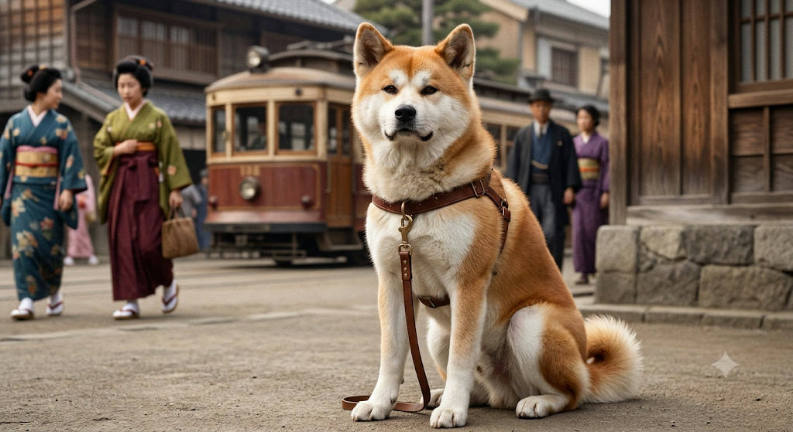
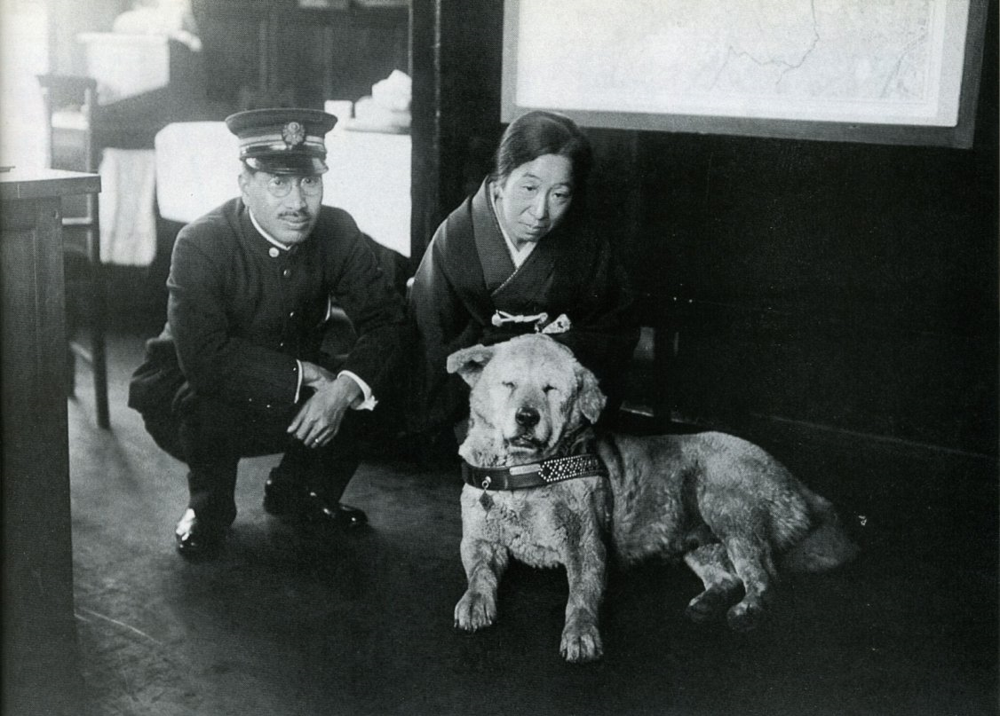
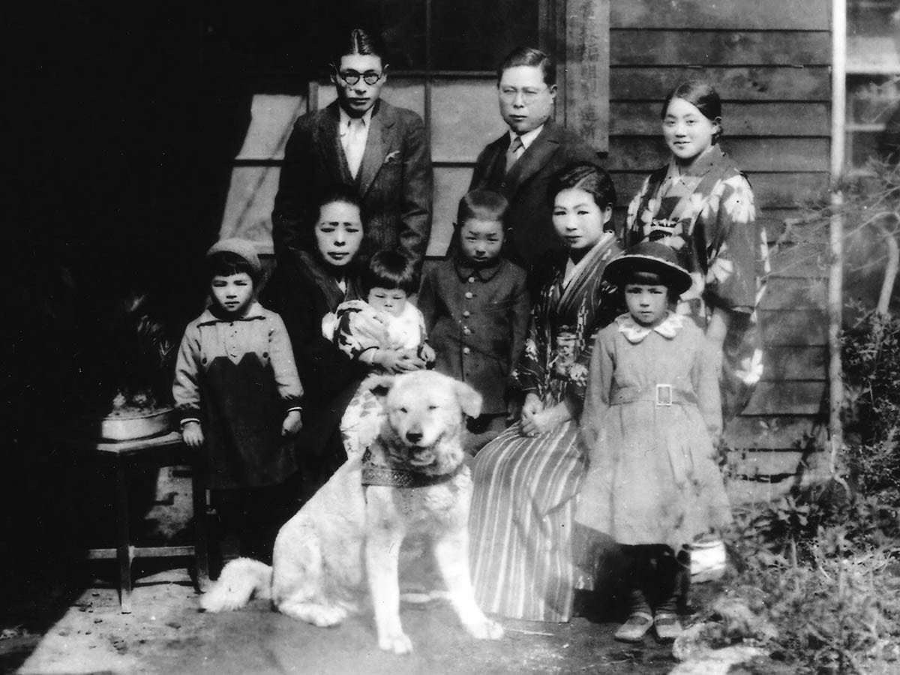
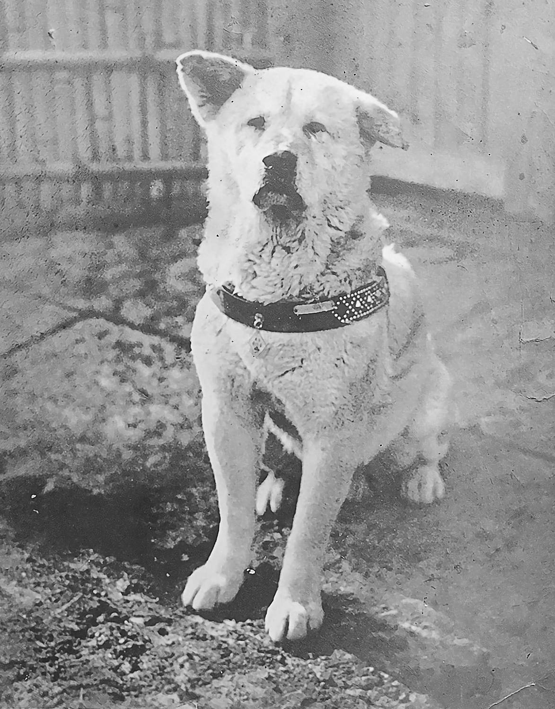
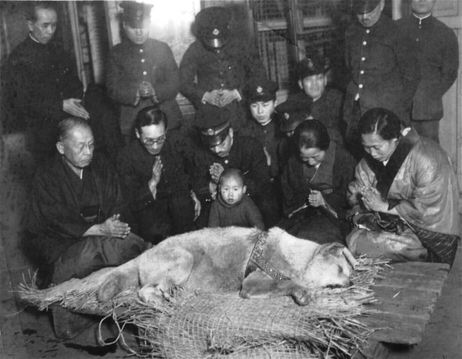
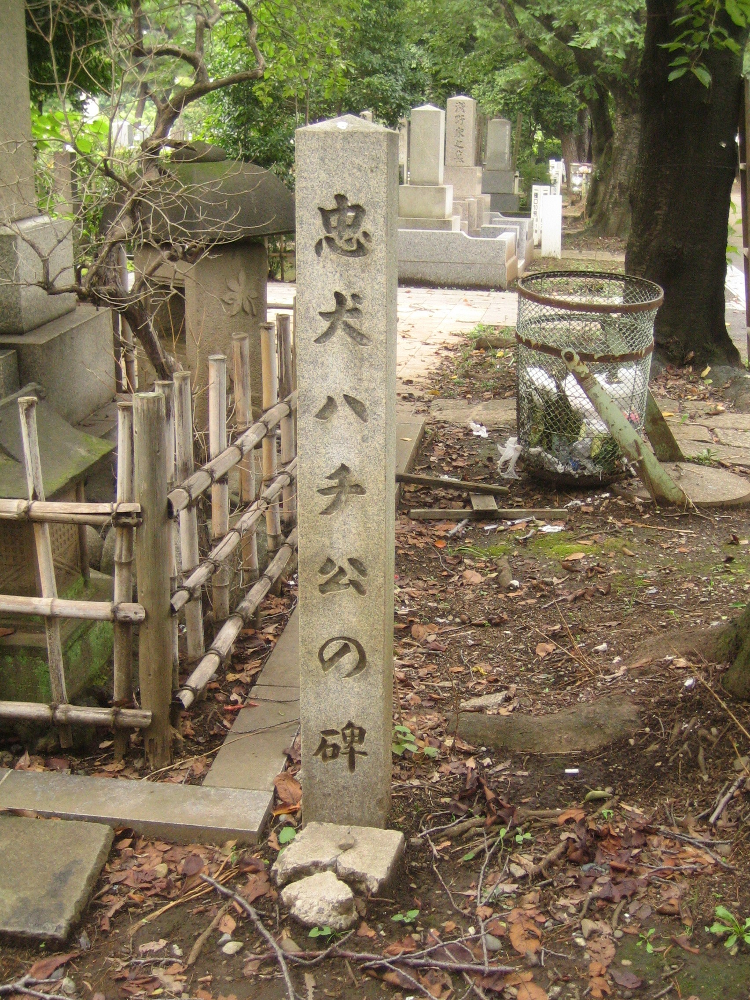
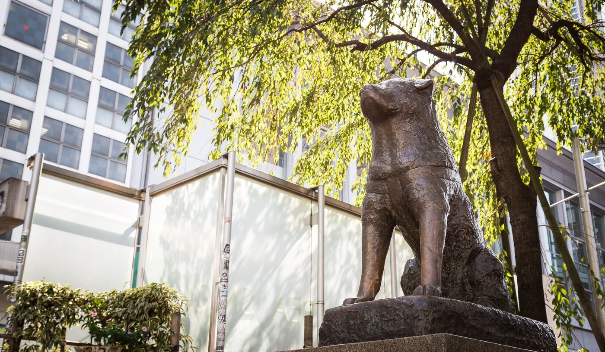
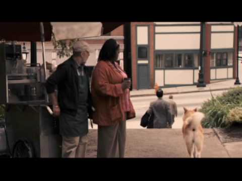
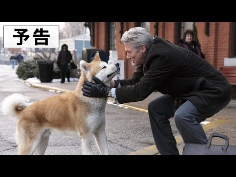

Mỗi ngày, Hachikō đều đến ga Shibuya.

Người qua đường nhìn thấy chú chó Akita màu vàng nhạt đứng trước nhà ga,
nghe tiếng tàu đến rồi đi, nhìn dòng người bước ra khỏi cổng. Chú vẫn đứng
đó, như thể chỉ cần kiên nhẫn thêm một chút, người chủ thân yêu sẽ xuất
hiện giữa đám đông.

Nhưng người ấy đã không bao giờ trở về nữa.

<figure class="story-figure">
  
  <figcaption>Minh họa AI về Hachikō trước một ga tàu Nhật Bản. Ảnh do chủ site cung cấp.</figcaption>
</figure>

<section class="story-gallery" aria-label="Hình ảnh và dấu ấn về Hachikō">
  

    <figure class="story-slide is-active">
      
      <figcaption>Hachikō xuất hiện bên bức tượng đầu tiên tại ga Shibuya, năm 1933.</figcaption>
    </figure>
    <figure class="story-slide">
      
      <figcaption>Hachikō cùng gia đình Hamano, một trong những gia đình từng chăm sóc chú.</figcaption>
    </figure>
    <figure class="story-slide">
      
      <figcaption>Một ảnh tư liệu lịch sử về Hachikō.</figcaption>
    </figure>
    <figure class="story-slide">
      
      <figcaption>Đám tang Hachikō năm 1935, khi câu chuyện của chú đã trở thành câu chuyện của cả thành phố.</figcaption>
    </figure>
    <figure class="story-slide">
      
      <figcaption>Nơi Hachikō được an nghỉ bên cạnh giáo sư Ueno tại nghĩa trang Aoyama.</figcaption>
    </figure>
    <figure class="story-slide">
      
      <figcaption>Tượng Hachikō tại Shibuya dưới tán cây. Ảnh: <a href="https://japagazine.com/archives/001/201905/large-c1bd15c00c1feab56f539fb0e07dff02.jpg" rel="noopener">Japagazine</a>.</figcaption>
    </figure>
    <figure class="story-slide">
      
      <figcaption>Khung hình từ trailer <em>Hachi: A Dog’s Tale</em> (2009), do SonyPicturesDVD phát hành trên YouTube.</figcaption>
    </figure>
    <figure class="story-slide">
      
      <figcaption>Khung hình từ trailer phiên bản Nhật <em>Hachi: Yakusoku no Inu</em>.</figcaption>
    </figure>
    

      
TỪ CÂU CHUYỆN ĐẾN VĂN HÓA ĐẠI CHÚNG

      <h2>Hachikō bước ra khỏi nhà ga</h2>
      

        Câu chuyện về chú chó trung thành đã được kể lại trong sách, phim
        Nhật Bản và bộ phim Hollywood <em>Hachi: A Dog’s Tale</em> (2009).
        Mỗi phiên bản có cách kể khác nhau, nhưng đều giữ lại một hình ảnh:
        một chú chó vẫn đứng ở nơi cũ, vì tình yêu không biết cách rời đi.
      

      

        <a href="https://www.imdb.com/title/tt1028532/" rel="noopener">Xem thông tin phim Hollywood</a>
        <a href="https://www.u-tokyo.ac.jp/focus/en/features/z1304_00275.html" rel="noopener">Đọc thêm tư liệu Đại học Tokyo</a>
      

    

    

      
ĐIỆN ẢNH HOLLYWOOD

      <h2><em>Hachi: A Dog’s Tale</em></h2>
      
Bộ phim năm 2009 do Richard Gere thủ vai chính, lấy cảm hứng từ câu chuyện Hachikō.

      

        <iframe src="https://www.youtube.com/embed/Y6U7mAnPtw4" title="Trailer Hachi: A Dog's Tale" loading="lazy" allow="accelerometer; autoplay; clipboard-write; encrypted-media; gyroscope; picture-in-picture" allowfullscreen></iframe>
      

    

  

  <button class="story-gallery-control story-gallery-prev" type="button" aria-label="Hình trước">←</button>
  <button class="story-gallery-control story-gallery-next" type="button" aria-label="Hình tiếp theo">→</button>
  

</section>

<section class="story-gallery film-still-gallery" aria-label="Mười khung hình từ trailer Hachi A Dog’s Tale">
  

    
    <figure class="story-slide is-active">
      
      <figcaption>Khung hình {{ frame }} từ trailer <em>Hachi: A Dog’s Tale</em> (2009). Nguồn video: SonyPicturesDVD / YouTube.</figcaption>
    </figure>
    
  

  <button class="story-gallery-control story-gallery-prev" type="button" aria-label="Khung hình trước">←</button>
  <button class="story-gallery-control story-gallery-next" type="button" aria-label="Khung hình tiếp theo">→</button>
  

</section>

## Một người chủ, một thói quen bình thường

Hachikō sinh năm 1923 tại thành phố Ōdate, tỉnh Akita, Nhật Bản. Năm 1924,
khi còn là một chú chó con, Hachikō được đưa đến sống cùng giáo sư
Hidesaburō Ueno, một giảng viên ngành nông nghiệp của Đại học Tokyo.

Giáo sư Ueno rất yêu chó. Mỗi ngày, Hachikō thường đi cùng ông đến ga
Shibuya vào buổi sáng rồi quay lại đón ông vào buổi chiều. Đối với cả hai,
đó chỉ là một thói quen nhỏ của một gia đình.

Không ai biết rằng thói quen ấy rồi sẽ trở thành một trong những câu chuyện
về lòng trung thành nổi tiếng nhất thế giới.

## Ngày người chủ không trở về

Ngày 21 tháng 5 năm 1925, giáo sư Ueno qua đời đột ngột tại trường đại học.
Chiều hôm đó, Hachikō vẫn đến ga Shibuya như thường lệ.

Chú chờ ở nơi quen thuộc, giữa những người xa lạ. Nhưng lần này, giáo sư
Ueno không bước ra khỏi nhà ga.

Sau khi chủ mất, Hachikō được đưa đến sống ở nhiều nơi khác nhau. Nhưng chú
thường tìm cách rời đi và quay lại ga Shibuya. Mỗi sáng, mỗi chiều, chú lại
đứng ở đó, nhìn những người khách qua lại và tìm kiếm một gương mặt quen
thuộc.

Hachikō không hiểu về cái chết theo cách con người hiểu. Có lẽ trong tâm trí
chú, giáo sư Ueno chỉ đang đi đâu đó rất lâu. Vì thế, chờ đợi vẫn là điều
duy nhất cần làm.

## Chín năm đứng trước nhà ga

Nhiều năm trôi qua, Hachikō già đi. Chú gầy hơn, lông xơ xác hơn và phải
đối mặt với những ngày tháng lạnh giá ngoài đường. Nhưng người dân quanh ga
Shibuya bắt đầu nhận ra chú.

Năm 1932, câu chuyện về chú chó ngày nào cũng đến ga chờ chủ được đăng trên
báo Asahi Shimbun. Từ đó, Hachikō được nhiều người biết đến. Hành khách
cho chú thức ăn, người dân chăm sóc chú, còn nhà ga trở thành nơi gắn với
tên tuổi của một chú chó chưa từng bỏ cuộc.

Hachikō qua đời ngày 8 tháng 3 năm 1935, sau gần mười năm kể từ ngày giáo
sư Ueno mất. Chú được tìm thấy ở khu vực gần ga Shibuya, nơi mình đã đến
vào mỗi ngày trong suốt những năm cuối đời.

## Bức tượng và câu hỏi về lòng trung thành

Bức tượng Hachikō đầu tiên được khánh thành tại ga Shibuya năm 1934, khi
chú vẫn còn sống và thậm chí đã có mặt trong buổi lễ. Bức tượng sau đó bị
tháo dỡ trong thời chiến để thu hồi kim loại. Tượng Hachikō hiện nay được
khánh thành sau chiến tranh vào năm 1948.

Ngày nay, bức tượng trở thành một điểm hẹn nổi tiếng của Tokyo. Người ta
đến đó để gặp nhau, chụp ảnh và bắt đầu những chuyến đi. Có thể nhiều người
không biết hết câu chuyện phía sau bức tượng, nhưng hình ảnh chú chó đứng
chờ vẫn gợi lên một cảm giác rất rõ ràng: có những tình cảm không biến mất
chỉ vì người ta không còn ở bên nhau.

Tại Đại học Tokyo cũng có một bức tượng mô tả khoảnh khắc giáo sư Ueno và
Hachikō gặp lại nhau. Đó không phải là cảnh chia tay hay cảnh chờ đợi, mà
là một cuộc đoàn tụ được tưởng tượng như điều mà Hachikō đáng lẽ phải có.

## Điều còn lại sau một cuộc chờ

Câu chuyện Hachikō thường được kể như một câu chuyện về lòng trung thành.
Nhưng có lẽ nó còn là câu chuyện về ký ức.

Hachikō nhớ con đường đến ga. Nhớ thời điểm đoàn tàu trở về. Nhớ mùi hương,
giọng nói và bước chân của một người từng đối xử với mình bằng tình yêu.
Mỗi ngày đi chờ có thể không đưa giáo sư Ueno trở lại, nhưng nó giữ lại
những ngày tháng hai người từng có với nhau.

Con người thường nghĩ mình là loài duy nhất biết yêu thương, biết nhớ và
biết đau buồn. Hachikō khiến chúng ta phải nhìn lại điều đó.

Chú chó không viết được một lá thư, không thể nói một lời tạm biệt, cũng
không thể giải thích vì sao mình vẫn quay lại ga. Chú chỉ làm một việc
duy nhất mà mình tin là đúng: chờ người chủ của mình.

Và sau gần một thế kỷ, hàng triệu người vẫn dừng lại trước bức tượng ở
Shibuya để nhớ về chú.

### Nguồn tham khảo

- [Đại học Tokyo: Câu chuyện Hachikō và giáo sư Ueno](https://www.en.a.u-tokyo.ac.jp/hachi_ueno_hp/hp/prospectus.htm)
- [Thư viện quận Shibuya: Lịch sử Hachikō](https://www.lib.city.shibuya.lg.jp/shibuya/about-shibuya/hachiko/)
- [Đại học Tokyo: Hachikō và những câu chuyện lịch sử](https://www.u-tokyo.ac.jp/focus/en/features/z1304_00275.html)
- [Ảnh tượng Hachikō tại Shibuya: Japagazine](https://japagazine.com/archives/001/201905/large-c1bd15c00c1feab56f539fb0e07dff02.jpg)
