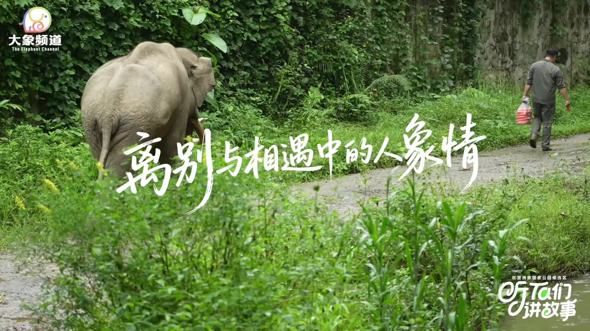

Ngày A Bảo trở về rừng, người chăm sóc chú mang theo một túi cà rốt.

Đó là việc anh đã làm rất nhiều lần trong suốt hơn năm năm: đến bên A Bảo,
gọi tên chú, đưa thức ăn và cùng chú đi qua những đoạn đường trong khu cứu
hộ voi châu Á ở Tây Song Bản Nạp, Vân Nam.

Nhưng ngày hôm ấy khác tất cả những ngày trước.

A Bảo sắp rời khỏi nơi đã trở thành mái nhà của mình. Chú sẽ trở về với
rừng, với đàn voi và với một cuộc sống không còn phụ thuộc vào con người.
Người chăm sóc biết đó là điều tốt nhất cho A Bảo, nhưng biết đúng không
đồng nghĩa với việc không buồn.

<figure class="story-figure story-figure-wide">
  
  <figcaption>A Bảo trong hành trình được huấn luyện bán hoang dã trước khi trở về rừng. Ảnh: Tân Hoa Xã.</figcaption>
</figure>

## Từ một chú voi lạc đường

A Bảo từng đi vào khu vực đô thị ở Phổ Nhĩ, Vân Nam. Sau đó, chú được đưa
đến Trung tâm Cứu hộ và Nhân giống Voi châu Á ở Tây Song Bản Nạp.

Khi mới đến, A Bảo không tin con người. Chú cảnh giác, khó tiếp cận và
không dễ dàng hợp tác trong các hoạt động chăm sóc. Đối với một con voi
từng sống ngoài tự nhiên, việc bị đưa đến một môi trường mới là một thay
đổi rất lớn.

Trung tâm không thể bắt A Bảo lập tức trở nên thân thiện. Họ phải bắt đầu
từ những việc nhỏ: xuất hiện ở một khoảng cách an toàn, đưa thức ăn đúng
giờ, quan sát phản ứng của chú và kiên nhẫn lặp lại mọi thứ.

Người chăm sóc A Bảo, được đồng nghiệp gọi là “cha voi”, dành phần lớn
thời gian để xây dựng mối quan hệ ấy. Anh hiểu rằng cứu hộ không chỉ là
đưa một con vật ra khỏi nguy hiểm. Cứu hộ còn là giúp nó lấy lại sự tự tin
để có thể sống mà không cần con người.

## Năm năm của sự tin tưởng

Trong hơn năm năm, A Bảo và người chăm sóc dần hình thành một nhịp sống
riêng. Người chăm sóc biết khi nào chú muốn được ở một mình, khi nào chú
sẵn sàng ra ngoài và món ăn nào có thể khiến chú tiến lại gần.

Ban đầu, họ không thể đi quá gần nhau. Sau đó, A Bảo bắt đầu cho phép người
chăm sóc đứng bên cạnh. Rồi chú quen với những chuyến đi ra khu vực bán
hoang dã, nơi A Bảo được học cách tìm thức ăn, di chuyển và phản ứng với
môi trường tự nhiên.

Mối quan hệ ấy không phải là việc biến A Bảo thành một con vật nuôi. Nó là
một cây cầu tạm thời, giúp một con voi từng cần người chăm sóc có thể
chuẩn bị cho ngày không còn người chăm sóc bên cạnh.

## Lần quay lại khiến mọi người bật khóc

Ngày thả A Bảo về rừng, mọi người nghĩ buổi chia tay sẽ kết thúc khi chú
voi bước qua ranh giới cây cối.

Nhưng sau khi đi được một đoạn, A Bảo quay lại.

Chú đứng bên người chăm sóc, không chịu rời đi ngay. Những người có mặt
hiểu rằng đây không phải là một chuyến thăm bình thường. Trong ký ức của
A Bảo, người đã chăm sóc mình suốt nhiều năm không chỉ là một nhân viên
cứu hộ. Đó là người đã xuất hiện mỗi ngày, mang thức ăn, giữ khoảng cách
đúng lúc và giúp chú không còn sợ hãi.

Người chăm sóc cũng không thể giữ A Bảo lại. Nếu giữ lại chỉ vì bản thân
không muốn chia tay, anh sẽ biến tình yêu của mình thành một chiếc lồng.

Vì vậy, anh đứng đó, chờ A Bảo bình tĩnh rồi tiếp tục bước vào rừng.

## Yêu một con vật là để nó được tự do

Sau khi trở về môi trường tự nhiên, A Bảo bắt đầu sống cùng đàn voi. Những
bức ảnh và thông tin theo dõi cho thấy chú dần thích nghi với cuộc sống
mới.

Người chăm sóc vẫn xem tin tức về A Bảo bất cứ khi nào có thời gian. Anh
vui khi thấy chú khỏe mạnh, nhưng cũng lo lắng khi A Bảo va chạm với những
con voi khác. Cảm giác ấy giống như nhìn một đứa con rời nhà: vừa tự hào,
vừa không thể ngừng quan tâm.

Điều làm câu chuyện của A Bảo trở nên cảm động không phải vì con voi nhớ
người. Mà vì con người đã đủ yêu thương để không giữ nó lại.

Có những mối quan hệ được chứng minh bằng việc ở bên nhau mỗi ngày. Cũng có
những mối quan hệ được chứng minh bằng việc biết lúc nào phải buông tay.

Người “cha voi” đã chăm sóc A Bảo để một ngày chú có thể không cần anh nữa.
Đó là một kiểu tình yêu rất khó: làm tất cả để mình trở nên không còn cần
thiết.

### Nguồn tham khảo

- [Tân Hoa Xã: Câu chuyện A Bảo trở về rừng](http://www.yn.news.cn/20260810/32876604697c40248c2fca0d1d6c7e5e/c.html)
- [Tân Hoa Xã: Bảo tồn voi châu Á tại Vân Nam](https://www.kunming.cn/news/c/2026-08-13/14066215.shtml)
