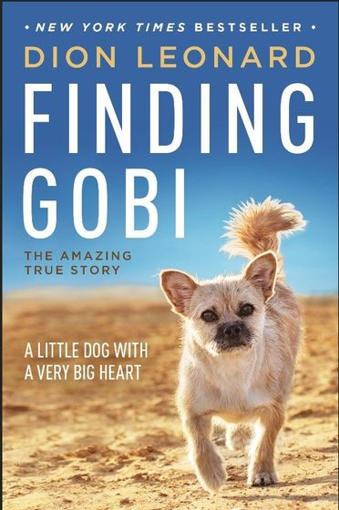

Ngày đầu tiên của cuộc đua, Dion Leonard nhìn thấy một chú chó nhỏ lang
thang quanh khu cắm trại.

Anh không nghĩ nhiều về nó. Một chú chó hoang giữa vùng sa mạc rộng lớn
có lẽ chỉ đang tìm thức ăn và một nơi tránh nắng. Nhưng sang ngày thứ hai,
khi các vận động viên chuẩn bị xuất phát, chú chó vẫn đứng đó.

Rồi nó chạy theo Dion.

<figure class="story-figure story-figure-wide">
  
  <figcaption>Hình ảnh Gobi trong ấn phẩm kể lại câu chuyện của Dion Leonard. Nguồn: Finding Gobi.</figcaption>
</figure>

## Bảy ngày giữa sa mạc

Cuộc đua Gobi March ở Trung Quốc kéo dài khoảng 250 km, chia thành nhiều
chặng qua sa mạc, núi đá và những vùng nắng nóng khắc nghiệt. Dion Leonard
là một vận động viên ultra-marathon, đã quen với việc chạy ở những nơi mà
phần lớn mọi người chỉ muốn đi qua thật nhanh.

Nhưng Gobi khiến cuộc đua trở nên khác hẳn.

Chú chó chạy bên cạnh anh qua nhiều chặng. Có lúc Gobi chạy trước, có lúc
quay lại nhìn như muốn giục anh nhanh hơn. Chú không được đăng ký, không
có giày chạy và cũng chẳng có người huấn luyện. Chú chỉ đơn giản là đã
chọn đi cùng Dion.

Gobi tham gia bốn trong sáu chặng của cuộc đua. Trong những khoảng nghỉ,
chú tìm đến lều của Dion để nằm cạnh anh. Dion cho Gobi thức ăn và nước,
còn Gobi đem đến một điều mà cuộc đua đường dài thường thiếu: một người bạn
không hỏi anh đang đứng thứ mấy.

## Một cái tên cho một mối quan hệ

Dion đặt tên cho chú chó là Gobi, theo tên vùng sa mạc nơi họ gặp nhau.
Anh từng nói rằng mình không thực sự nhận nuôi Gobi; chính Gobi mới là
người đã “nhận” anh.

Sau cuộc đua, Dion rời Trung Quốc nhưng bắt đầu làm thủ tục để đưa Gobi
về Scotland. Chú cần được kiểm tra sức khỏe, tiêm phòng và hoàn tất các
thủ tục cách ly. Trong thời gian đó, Gobi được một người bạn chăm sóc tại
Urumqi.

Dion nghĩ rằng phần khó nhất đã qua. Anh đã nhầm.

## Khi Gobi biến mất

Một ngày, Gobi bị mất tích.

Dion lập tức bay trở lại Trung Quốc. Anh phát tờ rơi, đăng thông tin lên
mạng xã hội và đi tìm quanh thành phố. Những người từng nghe câu chuyện
cũng tham gia giúp đỡ. Một chú chó hoang từng chạy bên một vận động viên
trong sa mạc giờ được rất nhiều người xa lạ cùng tìm kiếm.

Nhiều ngày trôi qua mà không có tin tức. Dion thừa nhận có lúc anh rất khó
giữ hy vọng. Nhưng anh không muốn dừng lại ở đó. Gobi đã chạy cùng anh
qua những chặng đường dài nhất; lần này đến lượt anh đi tìm Gobi.

Cuối cùng, Gobi được tìm thấy.

Khoảnh khắc hai người gặp lại nhau, Dion kể rằng cảm giác giống như họ
chưa từng xa cách. Gobi nhận ra anh, và cuộc đoàn tụ trở thành phần kết
đẹp nhất của câu chuyện.

## Không phải ai cũng đến để ở lại

Gobi sau đó được đưa về Scotland và trở thành thành viên trong gia đình
Dion. Câu chuyện của hai người được viết thành sách *Finding Gobi*, sau đó
được xuất bản ở nhiều quốc gia.

Nhưng điều đáng nhớ nhất không phải là cuốn sách hay sự nổi tiếng. Đó là
cách một chú chó nhỏ đã bước vào cuộc đời một người hoàn toàn xa lạ, rồi
khiến người ấy sẵn sàng quay lại một đất nước khác chỉ để tìm mình.

Gobi không biết cuộc đua là gì. Chú không hiểu thành tích, danh tiếng hay
những bài báo. Chú chỉ biết chạy về phía người mình đã chọn.

Đôi khi, một mối quan hệ bắt đầu rất đơn giản: một chú chó đứng bên đường,
một người chạy ngang qua, rồi cả hai quyết định không đi tiếp một mình.

### Nguồn tham khảo

- [BBC: Dion Leonard và Gobi đoàn tụ](https://www.bbc.com/news/world-asia-37182207)
- [NPR: Cuộc tìm kiếm Gobi](https://www.npr.org/sections/thetwo-way/2016/08/25/491359719/a-happy-ending-for-an-australian-ultramarathoner-and-chinese-stray-dog)
- [Finding Gobi: Trang chính thức của câu chuyện](https://www.findinggobi.com/)
