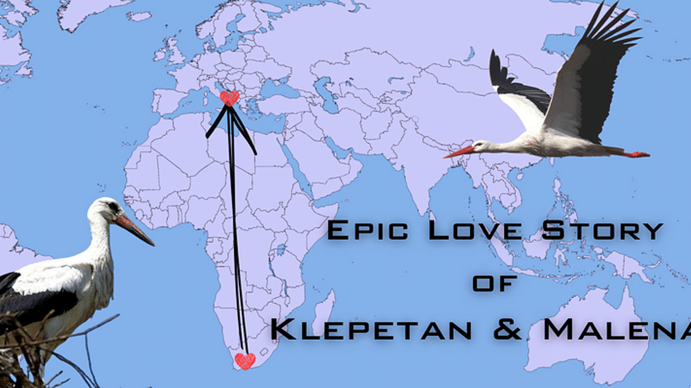

Mỗi mùa xuân, người dân ở Brodski Varoš, Croatia lại nhìn lên bầu trời.

Họ chờ một con cò trắng bay trở về từ châu Phi.

Không phải vì Klepetan là con chim duy nhất di cư qua vùng đất ấy, mà vì
mọi người biết chú đang bay về gặp Malena — người bạn đời không thể bay
theo mình.

<figure class="story-figure story-figure-wide">
  
  <figcaption>Klepetan và Malena trên bản đồ di cư. Hình: YourStory.</figcaption>
</figure>

## Malena không thể bay

Năm 1993, người chăm sóc tên Stjepan Vokić tìm thấy Malena bị thương. Một
bên cánh của cô bị thợ săn bắn, khiến Malena mất khả năng bay và không thể
tham gia chuyến di cư dài hàng nghìn cây số của loài cò.

Stjepan đưa Malena về chăm sóc. Ông làm một chiếc tổ trên mái nhà, chuẩn bị
thức ăn và tạo một nơi an toàn để cô có thể sống.

Malena ở lại Croatia.

Nhưng câu chuyện không dừng ở đó.

## Con cò trở về mỗi mùa xuân

Năm 2001, một con cò đực bắt đầu xuất hiện tại ngôi làng. Stjepan đặt tên
cho nó là Klepetan.

Kể từ đó, Klepetan bay từ miền nam châu Phi trở về Croatia mỗi năm. Quãng
đường dài khoảng 13.000 km, kéo dài nhiều tuần và đi qua những vùng đất,
biển và thời tiết khắc nghiệt.

<figure class="story-figure story-figure-wide route-map">
  
  <figcaption>Minh họa quãng đường di cư giữa Croatia và miền nam châu Phi, khoảng 13.000 km.</figcaption>
</figure>

Malena không thể bay đến gặp Klepetan. Vì vậy, Klepetan là người luôn quay
về.

Khi mùa đông đến, Klepetan lại bay đi. Malena ở lại cùng Stjepan. Đến mùa
xuân năm sau, cả làng lại chờ một bóng cò xuất hiện trên bầu trời.

## Gia đình trên mái nhà

Klepetan và Malena đã cùng nuôi nhiều thế hệ chim non. Vì Malena không thể
đi kiếm thức ăn và dạy con bay như những con cò khác, Klepetan đảm nhiệm
phần việc ấy.

Ông Stjepan giúp xây tổ, chăm sóc Malena và quan sát đàn cò lớn lên. Khi
chim non đủ sức, Klepetan đưa chúng vào hành trình di cư. Malena ở lại,
tiếp tục chờ mùa xuân mới.

Người dân trong làng dần coi ngày Klepetan trở về như một ngày hội. Tin
tức về đôi cò lan ra khắp Croatia, rồi đến nhiều quốc gia khác. Câu chuyện
được kể trên truyền hình, mạng xã hội và cả những chương trình tài liệu.

## Sau mùa xuân cuối cùng

Malena qua đời vào tháng 7 năm 2021, sau gần ba mươi năm được Stjepan
chăm sóc. Klepetan đã trở về nhiều lần trong những năm trước đó, nhưng
mùa xuân năm 2021 là lần cuối cùng họ gặp nhau.

Sau khi Malena mất, người dân vẫn nhìn lên bầu trời mỗi mùa xuân. Không còn
một đôi cò để chờ, nhưng câu chuyện về họ vẫn ở lại trong ngôi làng.

Klepetan và Malena không phải một câu chuyện tình hoàn hảo theo nghĩa con
người. Họ không thể ở bên nhau quanh năm. Một người phải ở lại, một người
phải bay đi. Nhưng sự xa cách không xóa được thói quen trở về.

Có những tình yêu không được đo bằng số ngày ở cạnh nhau. Chúng được đo
bằng việc, sau một hành trình dài đến đâu, người ta vẫn biết mình đang bay
về nơi nào.

### Nguồn tham khảo

- [BBC: Câu chuyện đôi cò ở Croatia](https://www.bbc.co.uk/programmes/articles/wpDBMVcxMmYBg58jCsfzG0/chance-meetings-that-sparked-wonderful-relationships)
- [HRT Croatia: Malena qua đời năm 2021](https://magazin.hrt.hr/price-iz-hrvatske/kraj-ljubavne-price-uginula-malena-2292640)
- [Croatian National Tourist Board: Klepetan và Malena](https://www.htz.hr/hr/press/htz-vijesti/ljubavna-prica-malene-i-klepetana-ispricana-na-drustvenim-mrezama)
- [Ảnh cover và bản đồ: YourStory](https://images.yourstory.com/cs/2/96eabe90392211eb93f18319e8c07a74/Imagembc4-1688567218214.jpg?mode=crop&crop=faces&ar=16:9&format=auto&w=3840&q=75)
