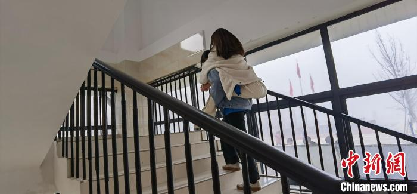
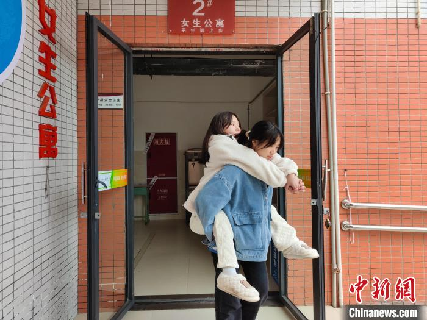
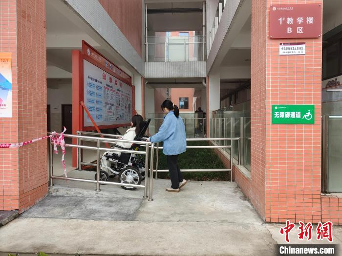
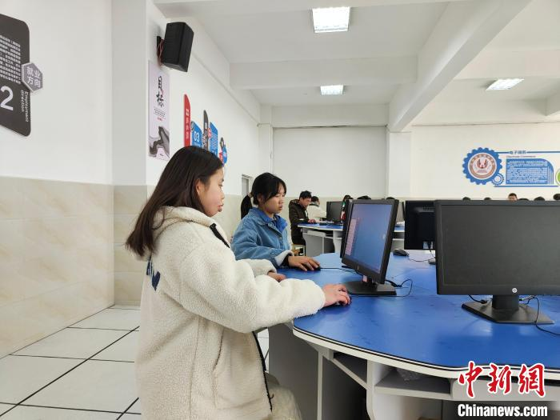

Mỗi buổi sáng, Trương Thải Hồng lại cúi người xuống trước mặt bạn.

Trần Thần nằm lên lưng bạn, hai tay vòng qua vai, còn Thải Hồng dùng tay
giữ chặt đôi chân của bạn để bạn không bị ngã. Từ lớp học đến ký túc xá,
từ phòng ăn đến cầu thang, hai cô gái cứ thế đi cùng nhau.

Một lần như vậy có thể là giúp đỡ.

Hai năm lặp lại mỗi ngày đã trở thành một lời hứa.

<figure class="story-figure story-figure-wide">
  
  <figcaption>Trương Thải Hồng cõng Trần Thần lên cầu thang. Ảnh: Lữ Tiệp / China News.</figcaption>
</figure>

## “Để mình cõng bạn”

Trần Thần mắc chứng loạn dưỡng cơ mặt-vai-cánh tay từ khi còn nhỏ. Căn
bệnh khiến cơ chân và cơ lưng dần yếu đi, cơ thể không thể tự nâng đỡ trong
thời gian dài. Việc đi bộ một đoạn ngắn cũng có thể khiến bạn kiệt sức.

Thải Hồng và Trần Thần quen nhau từ thời cấp hai. Khi đó, Thải Hồng đã
thường xuyên dìu bạn đi lại. Sau này, cả hai tình cờ học cùng lớp tại
Trường Kỹ thuật nghề Tam Đài ở Miên Dương, Tứ Xuyên.

Nhưng khi lên trung học, bệnh của Trần Thần nặng hơn. Những đoạn đường
bằng phẳng cũng trở nên khó khăn, còn cầu thang là một thử thách gần như
không thể vượt qua một mình.

Một ngày, Thải Hồng bước đến trước mặt bạn, hơi khuỵu gối xuống và nói:

> “Để mình cõng bạn.”

Thải Hồng cao khoảng 1 mét 60, nặng hơn 45 kg. Trần Thần nặng khoảng 35 kg.
Vóc dáng nhỏ bé ấy phải mang thêm một cơ thể gần bằng mình, nhưng Thải Hồng
không muốn đặt bạn xuống giữa đường.

Bạn nói rằng mình mệt, nhưng điều khiến bạn lo hơn là Trần Thần có thể gặp
nguy hiểm nếu phải tự đi một mình.

## Không chỉ là đến lớp

Trong hơn hai năm, Thải Hồng cõng Trần Thần lên xuống cầu thang, đưa bạn
vào lớp, đưa về ký túc xá và mang cơm đến khi bạn không thể tự đi lấy.
Bạn còn giúp Trần Thần lấy nước, làm những việc sinh hoạt hằng ngày và đến
đón bạn vào những ngày trời mưa.

Nhà Trần Thần có cha mẹ thường xuyên đi làm xa. Ông bà đã lớn tuổi, bà còn
bị liệt. Vì vậy, trong những năm học phổ thông, Thải Hồng gần như trở thành
người đồng hành gần gũi nhất của bạn.

Nhưng Trần Thần không chỉ là người được giúp.

Bạn có một tinh thần rất tích cực và luôn cố gắng học tập. Thải Hồng nói
rằng chính sự lạc quan của Trần Thần khiến bạn muốn giúp lâu dài hơn. Hai
người cùng học, cùng động viên nhau và cùng nói về một ước mơ: thi đỗ đại
học.

<figure class="story-figure">
  
  <figcaption>Thải Hồng đưa bạn ra khỏi ký túc xá. Ảnh: Lữ Tiệp / China News.</figcaption>
</figure>

## Khi lòng tốt được tiếp sức

Nhà trường sau đó chuyển lớp học và ký túc xá của Trần Thần xuống tầng một.
Một doanh nghiệp hỗ trợ xây dựng các lối đi không rào cản. Giáo viên mua
cho bạn một chiếc xe lăn điện để việc di chuyển trên mặt phẳng dễ dàng hơn.

Từ đó, Thải Hồng không phải cõng bạn trên mọi đoạn đường nữa. Hai người
vẫn đi cùng nhau, nhưng tình bạn đã có thêm sự hỗ trợ của nhà trường và
cộng đồng.

Nhà trường cũng tuyên dương Thải Hồng trong chương trình bình chọn học sinh
tiêu biểu hằng tháng. Thầy cô nhận xét bạn là người tử tế, có ý chí và luôn
sẵn lòng giúp người khác.

Điều đáng nói là Thải Hồng cũng có một hoàn cảnh không dễ dàng. Mẹ bạn
qua đời vì bệnh, cha làm nông để nuôi ba người con. Nhiều người từng khuyên
bạn nghỉ học để đi làm kiếm tiền phụ gia đình.

Nhưng Thải Hồng không muốn dừng lại. Bạn muốn học tiếp để thay đổi cuộc
đời mình, đồng thời vẫn không muốn bỏ mặc người bạn đang cùng mình đi qua
những năm tháng khó khăn.

<figure class="story-figure">
  
  <figcaption>Trần Thần và Thải Hồng trên đường đến lớp. Ảnh: Lữ Tiệp / China News.</figcaption>
</figure>

## Cùng nhau đi tiếp

Trên lưng Thải Hồng là sức nặng của một người bạn. Nhưng trên đôi vai của
cả hai còn có một thứ nặng hơn: mong muốn được tiếp tục học, được thi vào
đại học và được tự quyết định tương lai.

Thải Hồng không làm điều gì ồn ào. Bạn chỉ nhìn thấy một người cần giúp,
rồi cúi xuống.

Trần Thần cũng không chỉ nhận sự giúp đỡ. Bạn đáp lại bằng sự cố gắng, bằng
niềm tin và bằng việc nhắc người bạn của mình rằng hoàn cảnh hiện tại không
phải là giới hạn cuối cùng.

<figure class="story-figure">
  
  <figcaption>Hai người bạn trong một giờ thực hành. Ảnh: Lữ Tiệp / China News.</figcaption>
</figure>

Có những tình bạn không được tạo nên bởi những chuyến đi xa hay những kỷ
niệm lớn lao. Chúng được tạo nên từ những buổi sáng rất sớm, những bậc
thang dài và một câu nói ngắn:

> “Để mình cõng bạn.”

Rồi đến một ngày, người được cõng có thể tự đi bằng đôi chân của mình.
Nhưng tình bạn đã giúp họ đi xa hơn rất nhiều so với một đoạn đường từ
ký túc xá đến lớp học.

### Nguồn tham khảo

- [China News: Trương Thải Hồng cõng bạn khuyết tật đến lớp suốt hai năm](http://www.chinanews.com.cn/sh/2022/01-05/9644969.shtml)
