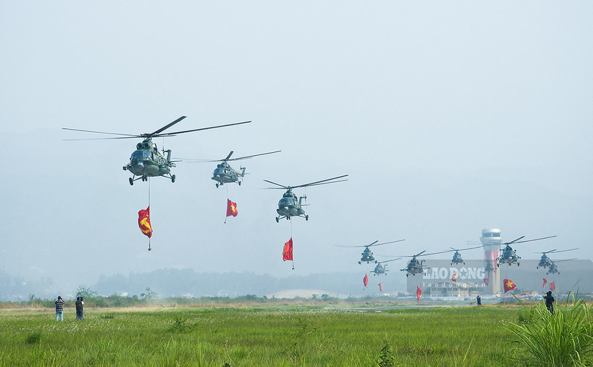
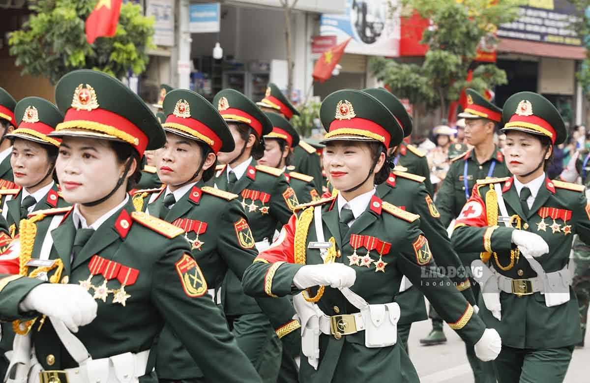
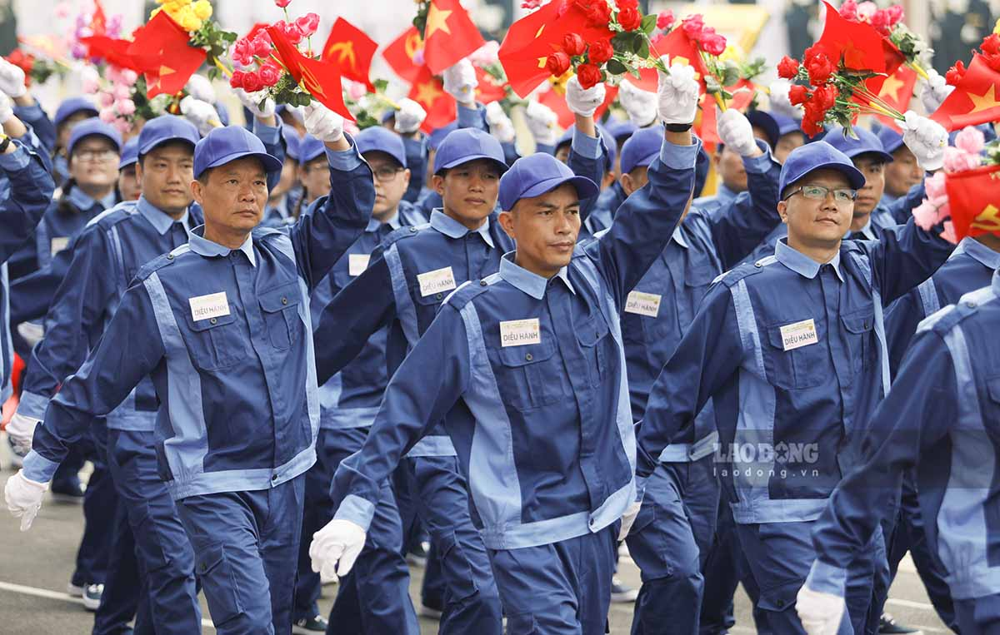
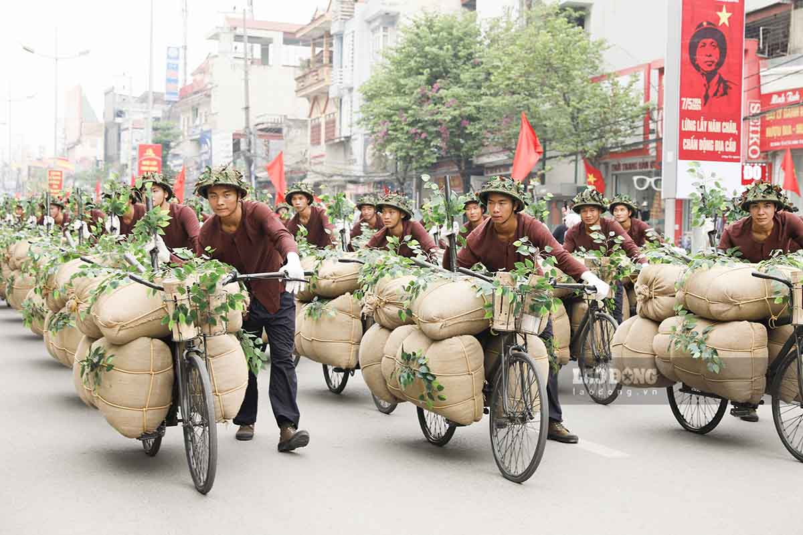

<section class="story-gallery" aria-label="Hình ảnh tư liệu lịch sử">
  

    <figure class="story-slide is-active">
      
      <figcaption>Ảnh tư liệu: <a href="https://commons.wikimedia.org/wiki/File:Dien_Bien_Phu_1954_French_prisoners.jpg" rel="noopener">Wikimedia Commons</a>.</figcaption>
    </figure>
    <figure class="story-slide">
      
      <figcaption>Ảnh tư liệu tại Bảo tàng Chiến thắng Điện Biên Phủ: <a href="https://commons.wikimedia.org/wiki/File:Contemporary_Photo_of_Vietnminh_Storming_across_Muong_Thanh_Bridge_(1954)_-_Dien_Bien_Phu_Victory_Museum_-_Dien_Bien_Phu_-_Vietnam_(48159225792).jpg" rel="noopener">Wikimedia Commons</a>.</figcaption>
    </figure>
    <figure class="story-slide">
      
      <figcaption>Ảnh tư liệu: <a href="https://commons.wikimedia.org/wiki/File:Victory_in_Battle_of_Dien_Bien_Phu.jpg" rel="noopener">Wikimedia Commons</a>.</figcaption>
    </figure>
  

  <button class="story-gallery-control story-gallery-prev" type="button" aria-label="Hình trước">←</button>
  <button class="story-gallery-control story-gallery-next" type="button" aria-label="Hình tiếp theo">→</button>
  

</section>

## Gallery lễ kỷ niệm 70 năm

<section class="story-gallery" aria-label="Hình ảnh lễ kỷ niệm 70 năm Chiến thắng Điện Biên Phủ">
  

    <figure class="story-slide is-active">
      
      <figcaption>Trực thăng mang cờ Đảng và cờ Tổ quốc bay qua lễ đài trong buổi tổng duyệt: <a href="https://laodong.vn/thoi-su/nhung-hinh-anh-an-tuong-truoc-le-ky-niem-70-nam-chien-thang-dien-bien-phu-1336040.ldo" target="_blank" rel="noopener noreferrer">Lao Động</a>.</figcaption>
    </figure>
    <figure class="story-slide">
      
      <figcaption>Khối nữ sĩ quan quân y trong đội hình diễu binh: <a href="https://laodong.vn/thoi-su/nhung-hinh-anh-an-tuong-truoc-le-ky-niem-70-nam-chien-thang-dien-bien-phu-1336040.ldo" target="_blank" rel="noopener noreferrer">Lao Động</a>.</figcaption>
    </figure>
    <figure class="story-slide">
      
      <figcaption>Khối công nhân Việt Nam trong đội hình diễu hành: <a href="https://laodong.vn/thoi-su/nhung-hinh-anh-an-tuong-truoc-le-ky-niem-70-nam-chien-thang-dien-bien-phu-1336040.ldo" target="_blank" rel="noopener noreferrer">Lao Động</a>.</figcaption>
    </figure>
    <figure class="story-slide">
      
      <figcaption>Khối dân công hỏa tuyến với những chiếc xe đạp thồ gợi nhớ hậu cần Chiến dịch Điện Biên Phủ: <a href="https://laodong.vn/thoi-su/nhung-hinh-anh-an-tuong-truoc-le-ky-niem-70-nam-chien-thang-dien-bien-phu-1336040.ldo" target="_blank" rel="noopener noreferrer">Lao Động</a>.</figcaption>
    </figure>
  

  <button class="story-gallery-control story-gallery-prev" type="button" aria-label="Hình trước">←</button>
  <button class="story-gallery-control story-gallery-next" type="button" aria-label="Hình tiếp theo">→</button>
  

</section>

## Video liên quan

<figure class="gallery-video">
  <iframe
    src="https://www.youtube-nocookie.com/embed/0ZmrOf1o37s"
    title="Video về Chiến thắng Điện Biên Phủ"
    loading="lazy"
    allow="accelerometer; autoplay; clipboard-write; encrypted-media; gyroscope; picture-in-picture"
    allowfullscreen></iframe>
  <figcaption class="gallery-video-caption">
    Tư liệu về Chiến thắng Điện Biên Phủ.
    <a href="https://www.youtube.com/watch?v=0ZmrOf1o37s" target="_blank" rel="noopener noreferrer">Xem video gốc trên YouTube</a>.
  </figcaption>
</figure>

## Vì sao Điện Biên Phủ trở thành điểm quyết chiến

Sau nhiều năm chiến tranh, quân Pháp muốn giành lại thế chủ động ở Đông
Dương. Kế hoạch Nava đặt mục tiêu tập trung lực lượng cơ động, tạo ra một
trận đánh lớn có thể làm suy yếu chủ lực của Việt Minh và buộc đối phương
phải chấp nhận một giải pháp có lợi cho Pháp.

Điện Biên Phủ nằm trong một thung lũng rộng ở vùng Tây Bắc, gần các tuyến
đường nối sang Thượng Lào. Với Pháp, đây là vị trí có thể vừa bảo vệ vùng
chiếm đóng ở Tây Bắc, vừa cắt đường tiến của lực lượng Việt Minh sang Lào.
Từ cuối năm 1953, quân Pháp đổ bộ, xây dựng nơi đây thành một tập đoàn cứ
điểm lớn chưa từng có trong chiến tranh Đông Dương.

Tập đoàn cứ điểm gồm nhiều cứ điểm liên kết với nhau, được chia thành các
cụm phòng ngự ở phía bắc, phía đông và khu trung tâm. Sân bay Mường Thanh
giữ vai trò đặc biệt quan trọng: nó đưa quân, đạn dược và lương thực từ
Hà Nội hoặc các căn cứ khác lên, đồng thời là con đường để tiếp tế và rút
quân. Khi sân bay bị khống chế, khả năng duy trì toàn bộ hệ thống phòng
ngự cũng bị đe dọa.

## Một chiến trường tưởng như khó tiếp cận

Điện Biên Phủ cách xa hậu phương, địa hình lại bị chia cắt bởi núi rừng,
đèo dốc và sông suối. Muốn đưa pháo hạng nặng, đạn dược và lương thực đến
gần trận địa, lực lượng vận tải phải mở đường, làm cầu, ngụy trang và
tránh sự phát hiện từ trên không.

Hậu cần của chiến dịch không chỉ là những đoàn xe. Dân công và bộ đội phải
khiêng, gùi, kéo hàng qua những đoạn đường chưa có đường lớn. Những chiếc
xe đạp thồ được gia cố để chở khối lượng lớn hơn nhiều so với cách sử dụng
thông thường. Ở những nơi xe không thể đi, con người phải đưa từng hòm
đạn, từng bao gạo và từng khẩu pháo tiến về phía trước.

Pháo binh cũng phải đối mặt với một nhiệm vụ đặc biệt khó khăn. Pháo được
đưa qua núi, kéo bằng sức người trên những con đường dốc, sau đó bố trí
trong các vị trí được che giấu. Việc giữ bí mật, bảo đảm đạn và duy trì
trận địa quan trọng không kém việc có vũ khí trong tay.

Nói đến hậu phương Điện Biên Phủ vì vậy không nên chỉ nói đến những con số
về lương thực hoặc phương tiện. Mỗi con số là hàng nghìn chuyến đi, những
đêm ngủ bên đường, những người bị thương vì tai nạn và những gia đình chờ
người thân trở về sau chiến dịch.

## Từ “đánh nhanh” đến “đánh chắc”

Trong quá trình chuẩn bị, phương án tác chiến được cân nhắc lại trước thực
tế của chiến trường. Một trận đánh nhanh có thể tạo bất ngờ, nhưng cũng
mang theo rủi ro rất lớn khi hệ thống phòng ngự của đối phương đã được củng
cố, có pháo binh, xe tăng và máy bay yểm trợ.

Phương châm **“đánh chắc, tiến chắc”** đòi hỏi thời gian chuẩn bị lâu hơn.
Các đơn vị phải xây dựng trận địa bao vây, đào hào tiếp cận, đưa pháo vào
vị trí có thể khống chế cứ điểm và tổ chức đường vận tải an toàn hơn. Cách
đánh này làm chiến dịch kéo dài, nhưng giảm nguy cơ đưa lực lượng vào một
cuộc đột kích thiếu chuẩn bị.

Những đường hào ngoằn ngoèo dần tiến gần các cứ điểm. Chúng giúp bộ đội
tiếp cận trong điều kiện hỏa lực dày đặc, đồng thời chia cắt từng khu vực
phòng ngự. Cuộc chiến vì thế không chỉ diễn ra trên mặt đất giữa các đợt
xung phong, mà còn diễn ra trong việc đào hào, giữ hào, phá hàng rào và
chuyển thương dưới bom pháo.

## Ba đợt tiến công

Chiến dịch bắt đầu ngày 13 tháng 3 năm 1954 và kết thúc ngày 7 tháng 5,
kéo dài 56 ngày đêm. Có thể hình dung diễn biến qua ba giai đoạn chính:

- **Đợt thứ nhất:** các cứ điểm Him Lam, Độc Lập và Bản Kéo ở phía bắc bị
  tiến công. Việc mất những vị trí này làm khu trung tâm bị thu hẹp và
  khiến sân bay Mường Thanh nằm trong tầm khống chế ngày càng rõ hơn.
- **Đợt thứ hai:** lực lượng Việt Minh tập trung vào các cứ điểm phía đông
  như những cao điểm bảo vệ trung tâm. Những trận đánh giằng co tại các
  cao điểm này đặc biệt ác liệt vì bên nào giữ được địa hình cao sẽ có
  lợi thế quan sát và khống chế lòng chảo.
- **Đợt thứ ba:** các tuyến phòng ngự còn lại bị siết chặt. Sân bay gần
  như không thể hoạt động bình thường, việc tiếp tế bằng đường không gặp
  nhiều khó khăn và bộ chỉ huy Pháp bị đẩy vào tình thế ngày càng cô lập.

Không nên hiểu ba đợt tiến công là ba bước tách rời hoàn toàn. Giữa các
đợt là những ngày pháo kích, đào hào, phản kích, sửa trận địa và chuyển
thương. Có những vị trí được giành đi giành lại, có những đoạn hào chỉ
cách nhau vài chục mét nhưng trở thành ranh giới giữa sự sống và cái chết.

## Cuộc chiến của những người ở dưới mặt đất

Hình ảnh chiến thắng thường được ghi lại ở thời điểm cờ được kéo lên trên
sở chỉ huy. Nhưng phần lớn thời gian của chiến dịch lại diễn ra trong
những căn hầm, giao thông hào và trận địa pháo. Người lính phải sống trong
đất ẩm, thiếu ngủ, thiếu nước và luôn đối mặt với pháo kích.

Người bị thương cần được đưa ra khỏi trận địa trong lúc đường hào bị ngập,
đất đá sạt xuống hoặc đối phương bắn chặn. Quân y phải làm việc với điều
kiện thiếu thuốc, thiếu dụng cụ và không gian chật hẹp. Người vận tải phải
đưa đạn lên phía trước rồi quay lại đưa thương binh về phía sau.

Phía bên kia, binh lính Pháp và quân thuộc Liên hiệp Pháp cũng bị mắc kẹt
trong một hệ thống phòng ngự bị thu hẹp dần. Họ chịu pháo kích, thiếu
không gian và phụ thuộc vào những chuyến máy bay tiếp tế. Nhìn nhận đầy đủ
về chiến tranh không làm giảm ý nghĩa của chiến thắng; ngược lại, nó giúp
thấy rõ hơn quy mô mất mát của tất cả những người bị cuốn vào trận đánh.

## Ngày 7 tháng 5 năm 1954

Đến đầu tháng 5, nhiều cứ điểm đã bị bao vây hoặc mất khả năng phối hợp.
Các trận đánh cuối cùng diễn ra dồn dập quanh khu trung tâm. Chiều 7 tháng
5, quân Việt Minh tiến vào sở chỉ huy tập đoàn cứ điểm. Tướng Christian de
Castries cùng bộ chỉ huy bị bắt, hệ thống phòng ngự Điện Biên Phủ chấm dứt.

Chiến thắng không phải kết quả của một khoảnh khắc riêng lẻ. Nó được tạo
nên bởi nhiều tháng chuẩn bị, sự phối hợp giữa các lực lượng, khả năng giữ
đường vận tải và sức chịu đựng của những người ở cả tiền tuyến lẫn hậu
phương. Lá cờ trên nóc hầm chỉ là hình ảnh cô đọng của một chiến dịch đã
đòi hỏi vô số công việc âm thầm.

## Từ chiến trường đến bàn đàm phán

Điện Biên Phủ có ý nghĩa vượt ra ngoài phạm vi một trận đánh. Thất bại của
tập đoàn cứ điểm làm thay đổi tương quan tại Hội nghị Genève về Đông Dương.
Hiệp định Genève năm 1954 dẫn đến việc chấm dứt chiến tranh ở Đông Dương
và đặt ra những sắp xếp chính trị, quân sự mới cho Việt Nam, Lào và
Campuchia.

Chiến thắng cũng gây tiếng vang lớn trong phong trào giải phóng dân tộc
trên thế giới. Nó cho thấy một lực lượng có hậu phương tổ chức tốt, có
chiến lược phù hợp và có khả năng huy động nhân dân có thể đánh bại một
đối thủ sở hữu ưu thế về trang bị và phương tiện hiện đại.

Tuy vậy, không nên kể Điện Biên Phủ như một câu chuyện chỉ có hào quang.
Sau chiến thắng là những người không trở về, những người mang thương tật,
những gia đình chờ tin và những năm tháng đất nước tiếp tục bị chia cắt.
Một dấu mốc lớn của lịch sử vẫn được tạo nên từ những cuộc đời cụ thể.

## Điều còn lại sau 56 ngày đêm

Điện Biên Phủ thường được nhớ bằng các cụm từ như “lừng lẫy năm châu” hay
“chấn động địa cầu”. Những cách gọi ấy phản ánh tầm vóc quốc tế của chiến
thắng, nhưng chưa nói hết câu chuyện của những người đã làm nên nó.

Điều đáng nhớ còn là sức mạnh của tổ chức, sự bền bỉ của hậu phương, khả
năng thích nghi trước một chiến trường khó khăn và tinh thần chịu đựng của
những người lính. Cũng cần nhớ rằng mỗi thắng lợi quân sự đều có một cái
giá con người rất lớn.

Nhìn Điện Biên Phủ trong series **Hòa bình không dễ có** là nhìn từ cả hai
phía: niềm tự hào về một bước ngoặt của lịch sử và sự tỉnh táo trước những
mất mát không thể đảo ngược. Nhớ về chiến thắng không phải để tôn vinh
chiến tranh, mà để hiểu vì sao hòa bình phải được giữ gìn.

### Nguồn tham khảo

- [Báo Nhân Dân: Trang thông tin đặc biệt 70 năm Chiến thắng Điện Biên Phủ](https://dienbienphu.nhandan.vn/)
- [Báo Nhân Dân: Những dấu mốc quan trọng trong đàm phán Hiệp định Geneva](https://nhandan.vn/nhung-dau-moc-quan-trong-trong-dam-phan-hiep-dinh-geneva-post818470.html)
- [Báo Nhân Dân: Chiến thắng Điện Biên Phủ – cách nhìn lịch đại](https://nhandan.vn/chien-thang-dien-bien-phu-cach-nhin-lich-dai-post804733.html)
