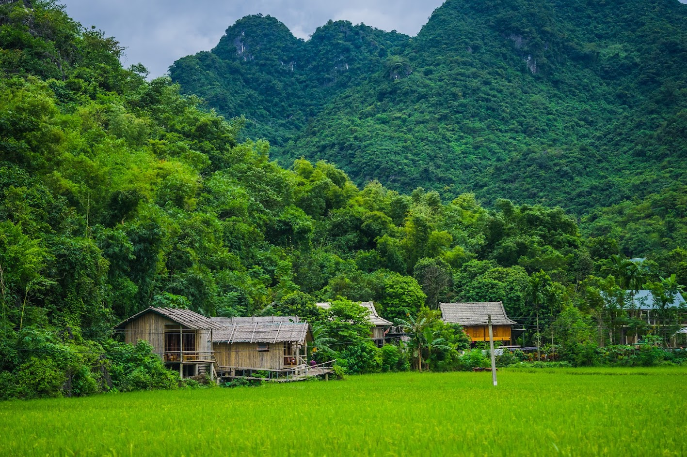
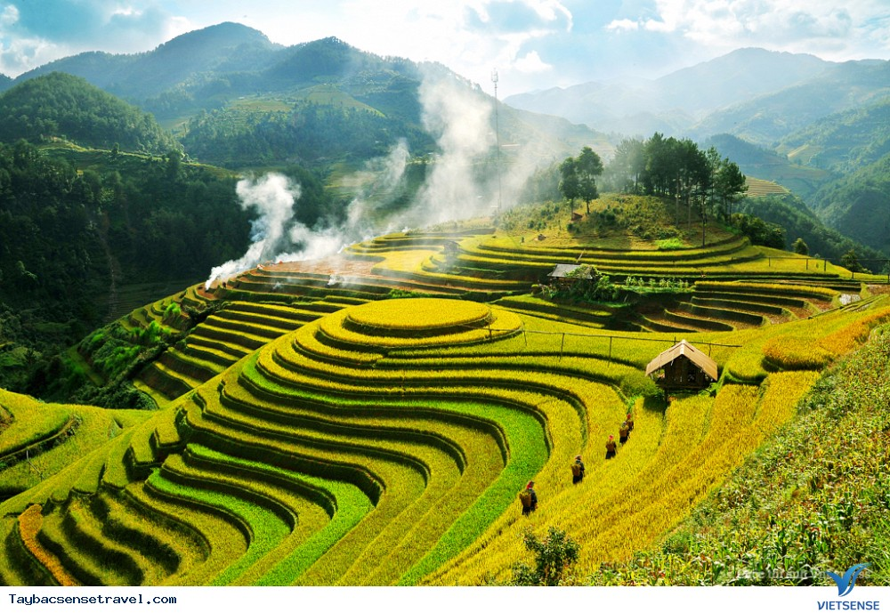
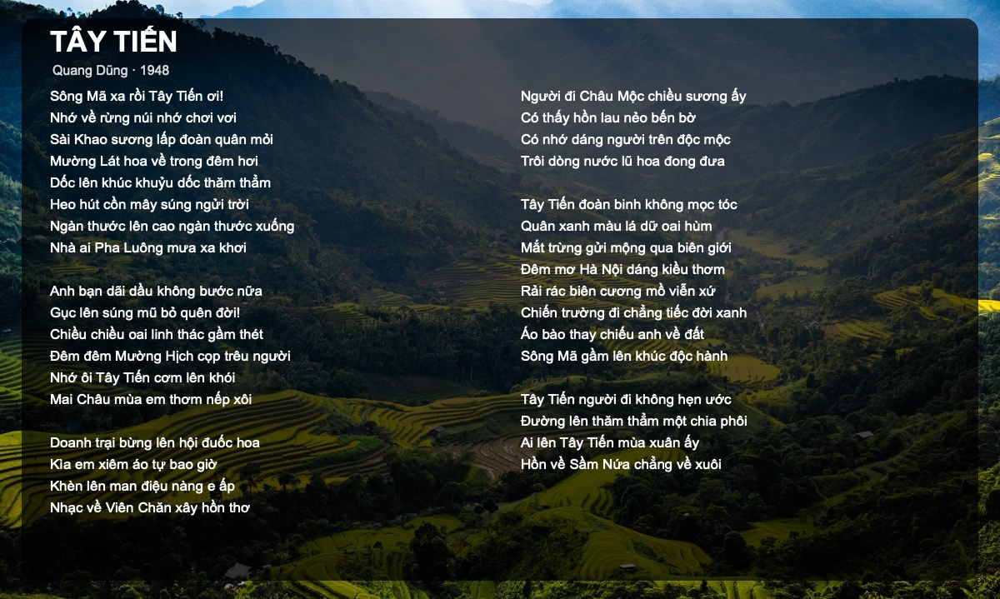

Nhắc đến Tây Tiến, nhiều người nhớ ngay đến những câu thơ của Quang Dũng:
núi cao, sương dày, những chặng đường dốc và hình ảnh người lính vừa hào
hùng vừa lãng mạn. Nhưng trước khi trở thành một bài thơ được học trong nhà
trường, Tây Tiến là tên của một đơn vị và là ký ức sống của những người đã
đi qua chiến trường miền Tây.

Đọc lịch sử Tây Tiến cần giữ được hai điều cùng lúc. Một mặt, phải trân
trọng vẻ đẹp của tuổi trẻ, tình đồng đội và tinh thần chiến đấu. Mặt khác,
không được để chất lãng mạn của thơ ca che khuất bệnh tật, thiếu thốn,
những cuộc hành quân kiệt sức và những người đã không thể trở về.

<section class="story-gallery" aria-label="Hình ảnh tư liệu về vùng Tây Tiến">
  

    <figure class="story-slide is-active">
      
      <figcaption>Mộc Châu, một địa danh gắn với vùng hoạt động của Trung đoàn Tây Tiến: <a href="https://commons.wikimedia.org/wiki/File:MocChau.jpg" rel="noopener">Wikimedia Commons</a>.</figcaption>
    </figure>
    <figure class="story-slide">
      
      <figcaption>Tuyến đường qua Mộc Châu ngày nay: <a href="https://commons.wikimedia.org/wiki/File:Quốc_lộ_6_qua_địa_phận_thị_trấn_Mộc_Châu.jpg" rel="noopener">Wikimedia Commons</a>.</figcaption>
    </figure>
    <figure class="story-slide">
      
      <figcaption>Phong cảnh Mai Châu, gợi không gian núi rừng miền Tây Bắc: <a href="https://vj-prod-website-cms.s3.ap-southeast-1.amazonaws.com/depositphotos416716766xl-1736818922029.jpg" target="_blank" rel="noopener noreferrer">nguồn ảnh</a>.</figcaption>
    </figure>
    <figure class="story-slide">
      
      <figcaption>Ruộng bậc thang vùng Tây Bắc: <a href="https://taybacsensetravel.com/view/at_nhung-hinh-anh-du-lich-dep-me-hon-cua-vung-dat-tay-bac_019194d3614616680f8a580c1f6a964e.jpg" target="_blank" rel="noopener noreferrer">nguồn ảnh</a>.</figcaption>
    </figure>
    <figure class="story-slide">
      
      <figcaption>Một hình minh họa cho bài thơ <em>Tây Tiến</em>, do bạn đọc cung cấp: <a href="https://encrypted-tbn0.gstatic.com/images?q=tbn:ANd9GcTQPvlfUNy4ZyR-dIbT2F45RqcZQTm5cDkqtQIDJmKImANaXUSKtOvGFBU&amp;s=10" target="_blank" rel="noopener noreferrer">nguồn ảnh</a>.</figcaption>
    </figure>
  

  <button class="story-gallery-control story-gallery-prev" type="button" aria-label="Hình trước">←</button>
  <button class="story-gallery-control story-gallery-next" type="button" aria-label="Hình tiếp theo">→</button>
  

</section>

## Video liên quan

  <iframe
    src="https://www.youtube-nocookie.com/embed/r1PFMI0pjEo"
    title="Video về Tây Tiến"
    loading="lazy"
    allow="accelerometer; autoplay; clipboard-write; encrypted-media; gyroscope; picture-in-picture"
    allowfullscreen></iframe>

## Một đơn vị ở miền Tây

Trung đoàn Tây Tiến được thành lập ngày 27 tháng 2 năm 1947. Sau đó, đơn
vị mang tên Trung đoàn 52 Tây Tiến. Nhiệm vụ của trung đoàn là phối hợp với
lực lượng địa phương, bảo vệ khu vực Tây Bắc và hỗ trợ lực lượng kháng
chiến ở vùng Thượng Lào.

Địa bàn hoạt động trải rộng qua những vùng núi phía Tây Bắc và khu vực
Sầm Nưa của Lào. Đường đi xa, địa hình phức tạp, giao thông khó khăn. Một
đơn vị có thể phải hành quân qua rừng, vượt dốc, băng suối rồi lại nhanh
chóng chuyển sang một địa bàn khác.

Thành phần của Tây Tiến cũng không nên được mô tả quá đơn giản. Đơn vị
gồm nhiều lực lượng và nguồn gốc khác nhau: chiến sĩ từ các khu vực, bộ
đội, tự vệ chiến đấu, thanh niên, học sinh và trí thức. Có những người từng
sống ở thành phố, nhưng khi vào quân ngũ phải học cách tồn tại giữa núi
rừng và chia sẻ mọi thiếu thốn với đồng đội.

Quang Dũng từng là đại đội trưởng trong đơn vị. Những gì ông viết về Tây
Tiến không phải là một câu chuyện đứng ngoài chiến tranh, mà là ký ức của
một người đã trực tiếp sống cùng những người lính ấy.

## Con đường gian khổ hơn câu thơ

Trong bài thơ, Tây Tiến hiện ra qua những dốc núi, chiều sương, mưa xa
khơi và những bản làng miền Tây. Những hình ảnh ấy đẹp, nhưng vẻ đẹp đó
được tạo nên từ một thực tế rất khắc nghiệt.

Người lính phải đi trong điều kiện thiếu lương thực, thiếu thuốc men và
thiếu phương tiện vận chuyển. Địa hình núi rừng làm việc cứu chữa người
bệnh và người bị thương trở nên khó khăn. Sốt rét và các bệnh nhiệt đới là
một mối đe dọa thường xuyên. Nhiều người kiệt sức hoặc qua đời không phải
chỉ trong một trận đánh, mà sau những ngày dài hành quân và chống chọi với
bệnh tật.

Đó là lý do khi đọc câu thơ “Tây Tiến đoàn binh không mọc tóc”, không nên
chỉ xem đây là một hình ảnh lạ hoặc có tính tạo hình. Nó gợi đến dấu vết
của bệnh tật và những tháng ngày khắc nghiệt. Nhưng Quang Dũng không viết
người lính như những con người bị đánh bại. Trong thơ, họ vẫn giữ được
dáng đứng, ý chí và tình yêu.

## Tuổi trẻ giữa chiến trường

Nhiều người lính Tây Tiến còn rất trẻ. Họ rời gia đình khi đất nước vừa
giành được độc lập chưa lâu, trong lúc tương lai của chính mình còn chưa
được định hình. Có người đang học, có người đã tham gia tự vệ ở thành phố,
có người đến từ những vùng quê khác nhau.

Tuổi trẻ của họ không chỉ có những cuộc hành quân. Đó còn là những buổi
ngồi bên nhau, những câu chuyện về gia đình, những lần nhớ phố, nhớ người
thân và những khoảnh khắc vui hiếm hoi giữa hoàn cảnh thiếu thốn. Tình đồng
đội hình thành từ chính những điều bình thường ấy: chia nhau một phần cơm,
giúp nhau qua dốc, cõng người bệnh và giữ im lặng khi đồng đội cần nghỉ.

Nếu chỉ gọi họ là “những người lính hào hoa”, ta sẽ bỏ quên phần người rất
đỗi bình thường của họ. Họ cũng sợ hãi, mệt mỏi và nhớ nhà. Điều đáng quý
không phải là họ không biết sợ, mà là họ vẫn làm nhiệm vụ trong khi biết
rằng phía trước có thể là bệnh tật, phục kích hoặc một cuộc hành quân
không có ngày trở lại.

## Những người đã nằm lại

Không có một con số đơn giản nào có thể kể hết tổn thất của Trung đoàn Tây
Tiến. Những người hy sinh nằm lại ở nhiều địa bàn, nhiều chặng đường và
trong nhiều hoàn cảnh khác nhau. Có người ngã xuống trong chiến đấu, có
người qua đời vì bệnh tật, có người mất trong những chuyến hành quân xa
đơn vị.

Trong chiến tranh, một cái chết không chỉ là mất đi một người lính. Đó còn
là một gia đình mất con, một người mẹ mất người con trai, một người vợ mất
chồng hoặc một người bạn không còn gặp lại người đã cùng mình vượt qua
những con dốc. Vì vậy, khi nhắc đến Tây Tiến, cần dành chỗ cho cả những
người đã hy sinh và những người sống sót mang theo ký ức suốt phần đời còn
lại.

Những ngôi mộ không phải lúc nào cũng được đánh dấu ngay. Có người được
đồng đội chôn cất vội bên đường. Có người nằm lại ở vùng đất xa quê. Nhiều
năm sau, việc tìm kiếm và quy tập hài cốt mới có thể tiếp tục. Khoảng cách
giữa ngày một người hy sinh và ngày gia đình biết được nơi người đó nằm
lại đôi khi kéo dài qua nhiều thế hệ.

## Từ lịch sử đến bài thơ

Quang Dũng viết bài thơ *Tây Tiến* năm 1948, sau thời gian sống và chiến
đấu cùng đơn vị. Bài thơ không phải là bản thống kê quân sự, cũng không
thay thế cho hồ sơ của từng người lính. Nó là một cách ghi nhớ bằng ngôn
ngữ nghệ thuật: vừa dữ dội, vừa mộng mơ; vừa có vẻ đẹp lãng mạn, vừa có
những nét bi tráng.

Vì thế, cần đọc bài thơ cùng với lịch sử chứ không dùng bài thơ để thay
cho lịch sử. Câu chữ có thể làm một thời đại trở nên đẹp hơn, nhưng nhiệm
vụ của người viết lịch sử là trả lại cho thời đại ấy cả những thiếu thốn,
những nỗi sợ và những cái tên đã bị chiến tranh lấy mất tương lai.

## Hòa bình nhìn từ một đoàn quân trẻ

Tây Tiến thường được nhớ bằng vẻ đẹp của núi rừng và khí phách của người
lính. Nhưng nếu nhìn sâu hơn, ta sẽ thấy một câu hỏi buồn: có bao nhiêu
người trong số họ đã không có cơ hội trở về để sống tiếp cuộc đời của mình?

Họ có thể đã trở thành người thầy, người cha, người nông dân, nhà văn hoặc
một người già ngồi kể chuyện cho cháu nghe. Chiến tranh đã khép lại những
khả năng ấy. Đó là phần mất mát không thể đo bằng bản đồ hay số liệu quân
sự.

Nhớ về Tây Tiến không phải để ca ngợi chiến tranh. Nhớ là để hiểu vì sao
những người trẻ đã phải đi qua núi rừng, bệnh tật và cái chết; để biết
trân trọng những người đã hy sinh; và để hiểu rằng hòa bình hôm nay được
đổi bằng những năm tháng mà không ai nên lãng quên.

### Nguồn tham khảo

- [Bảo tàng Lịch sử Quốc gia: Chuyện kể về những chiến sĩ đi Tây Tiến](https://baotanglichsu.vn/VI/Articles/3098/71332/chuyen-ke-ve-liet-si-cao-tu-cuong-tieu-djoi-truong-chi-djoi-giai-phong-quan-djau-tien-dji-tay-tien-1945.html)
- Báo Nhân Dân và VOV: tư liệu về Trung đoàn 52 Tây Tiến và Khu di tích
  lịch sử Tây Tiến.
- Các tư liệu nghiên cứu về Quang Dũng và bài thơ *Tây Tiến*.
